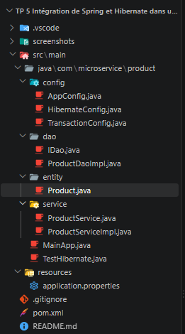
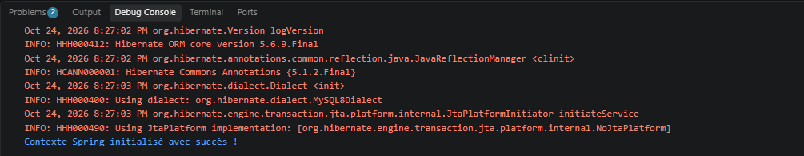
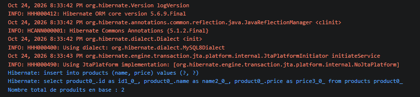
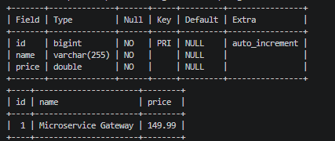

# TP 5 : Intégration de Spring et Hibernate dans une Architecture Microservices

Module **Architecture Microservices** (4e année ingénierie, DSI).

## Objectif du TP

Construire la couche de persistance d'un microservice `microservice-product` en combinant :

- **Spring 5.3.20** (sans Spring Boot) pour l'injection de dépendances, la configuration Java et la gestion des transactions ;
- **Hibernate 5.6.9.Final** comme ORM pour enregistrer et lire des objets `Product` dans une base **MySQL**.

L'application ajoute un produit (« Microservice Gateway », 149.99) via la couche service, puis affiche le nombre de produits en base.

## Prérequis

| Outil | Version |
|-------|---------|
| JDK   | 11 ou plus (testé avec JDK 21) |
| Maven | 3.6 ou plus |
| MySQL | 8.x, en écoute sur `localhost:3306` (testé avec MySQL 8.4 de Laragon) |

Avant de lancer, vérifiez les identifiants MySQL dans `src/main/resources/application.properties` :

```properties
jdbc.username=root
jdbc.password=        # votre mot de passe MySQL (vide par défaut avec Laragon / XAMPP)
```

La base `product_db` est créée automatiquement (`createDatabaseIfNotExist=true`), et Hibernate crée la table `products` (`hbm2ddl.auto=update`).

> Si votre utilisateur MySQL 8 a un mot de passe et que la connexion échoue avec
> « Public Key Retrieval is not allowed », ajoutez `&allowPublicKeyRetrieval=true` à la fin de `jdbc.url`.

## Structure des packages

```
microservice-product
├── pom.xml
└── src/main
    ├── java/com/microservice/product
    │   ├── entity/Product.java              (étape 3)
    │   ├── dao/IDao.java                    (étape 4)
    │   ├── dao/ProductDaoImpl.java          (étape 5)
    │   ├── config/HibernateConfig.java      (étape 6)
    │   ├── config/TransactionConfig.java    (étape 7)
    │   ├── service/ProductService.java      (étape 8)
    │   ├── service/ProductServiceImpl.java  (étape 8)
    │   ├── config/AppConfig.java            (étape 9)
    │   ├── TestHibernate.java               (étape 10)
    │   └── MainApp.java                     (étape 11)
    └── resources/application.properties     (étape 2)
```

## Commandes pour lancer

```bash
# Compilation
mvn clean compile

# Étape 10 : vérifier que le contexte Spring démarre
mvn compile exec:java -Dexec.mainClass=com.microservice.product.TestHibernate

# Étape 11 : application principale (classe par défaut du plugin exec)
mvn compile exec:java
```

Sorties obtenues :

```
Hibernate: create table products (id bigint not null auto_increment, name varchar(255) not null, price double precision not null, primary key (id)) engine=InnoDB
Contexte Spring initialisé avec succès !
```

```
Hibernate: insert into products (name, price) values (?, ?)
Hibernate: select product0_.id as id1_0_, product0_.name as name2_0_, product0_.price as price3_0_ from products product0_
Nombre total de produits en base : 1
```

(Le total augmente de 1 à chaque exécution de `MainApp`.)

### Lancer depuis VS Code

Installez l'extension recommandée **Extension Pack for Java** (proposée automatiquement à l'ouverture du dossier). Ensuite, dans l'onglet *Exécuter et déboguer*, choisissez la configuration **TestHibernate** ou **MainApp**. La sortie s'affiche dans la *Console de débogage*.

## Captures d'écran



*Structure du projet : les packages `entity`, `dao`, `service` et `config` correspondent aux couches de l'architecture.*



*TestHibernate : Hibernate crée la table `products` et le contexte Spring démarre sans erreur.*



*MainApp : le produit est inséré via la couche service (requête `insert` générée par Hibernate), puis le nombre total de produits en base est affiché.*



*La table `products` de la base `product_db`, ouverte dans HeidiSQL, contient la ligne insérée par MainApp.*

## Rôle de chaque couche

- **entity** : `Product` est une classe annotée `@Entity`. Hibernate la fait correspondre à la table `products` (une instance = une ligne).
- **dao** : `IDao<T>` définit les opérations CRUD génériques. `ProductDaoImpl` (`@Repository`) les implémente avec la `Session` Hibernate obtenue par `getCurrentSession()`, c'est-à-dire la session de la transaction en cours.
- **service** : `ProductService` / `ProductServiceImpl` (`@Service`, `@Transactional`) contiennent la logique métier : un prix négatif est refusé avec une `IllegalArgumentException`. Spring ouvre et valide (ou annule) la transaction autour de chaque méthode.
- **config** :
  - `HibernateConfig` crée la `DataSource` et la `SessionFactory` à partir de `application.properties` ;
  - `TransactionConfig` active `@Transactional` et déclare le `HibernateTransactionManager` ;
  - `AppConfig` scanne tout le package `com.microservice.product` pour enregistrer les beans.

## Corrections apportées à l'énoncé

Chaque correction est aussi signalée par un commentaire `CORRECTION énoncé` dans le code.

1. **`TransactionConfig`** : l'import `org.SessionFactory` n'existe pas. Il est remplacé par `org.hibernate.SessionFactory`.
2. **`pom.xml`** : ajout du driver MySQL `com.mysql:mysql-connector-j:8.0.33`, sans lequel on obtient `ClassNotFoundException: com.mysql.cj.jdbc.Driver`.
3. **`pom.xml`** : ajout de `maven.compiler.source/target = 11` et de l'encodage `UTF-8`.
4. **`ProductServiceImpl`** : la classe fait maintenant `implements ProductService`. L'énoncé demandait l'interface sans l'utiliser.
5. **`MainApp`** : avec `@Transactional` et une interface, Spring crée un **proxy JDK** qui implémente seulement `ProductService`. Le bean doit donc être récupéré par `context.getBean(ProductService.class)`. `getBean(ProductServiceImpl.class)` provoque une `NoSuchBeanDefinitionException`.
6. **`pom.xml`** : ajout de `exec-maven-plugin` pour lancer `MainApp` et `TestHibernate` en ligne de commande.

---

Réalisé avec l'assistance de Claude Code.
